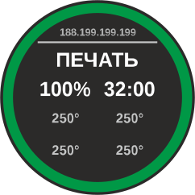
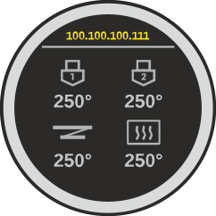
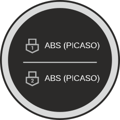
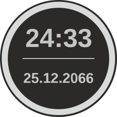
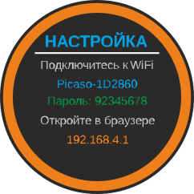
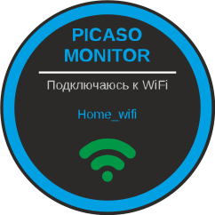
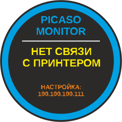
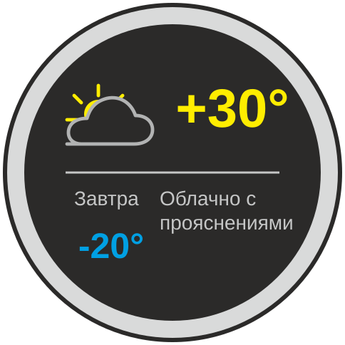

# Настольный монитор принтеров PICASO 3D на основе ESP32-2424S012

Прошивка превращает плату ESP32-2424S012 в сетевой монитор 3D-принтера PICASO. Дисплей показывает состояние печати, процент выполнения, оставшееся время, температуры, профили материалов, часы и погоду.

Устройство получает состояние принтера по локальной сети и не отправляет команды управления печатью.

**Текущая версия: 1.1.** В ней добавлен экран погоды и готовый комплект установщика для Windows.

## Лицензия

Оригинальный исходный код и другие оригинальные материалы проекта распространяются по лицензии GNU General Public License версии 3.0 (GPL-3.0-only). Полный текст находится в [LICENSE](LICENSE); идентификатор лицензии указан в заголовках исходных файлов. Официальная страница лицензии: <https://www.gnu.org/licenses/gpl-3.0.html>.

Внешние библиотеки сохраняют собственные лицензии. `include/arial_fonts.h` содержит растровые глифы, сгенерированные из локально установленного Arial; SVG-макеты в `design/` включают определения этого шрифта. Уведомление GPL проекта не распространяет права на Arial и не заменяет проверку условий распространения этих материалов.

## Возможности

- Три экрана с состоянием, температурами и профилями пластика; экран с датой и временем показывается в каждом третьем цикле. При настроенном городе экран погоды добавляется в конец основного цикла: `1–2–4–3–1–4–2–3–4–8` (50 секунд).
- Прогресс печати отображается зелёной дугой по ободу; в остальных состояниях дуга серая.
- Цвет статуса соответствует состоянию принтера: ожидание, готовность, подготовка, печать, пауза, завершение, ошибка, сервис, отсутствие связи или Wi-Fi.
- Десять пиксельных эмодзи случайно появляются на 5 секунд с интервалом от 3 до 15 минут.
- Веб-интерфейс настраивает Wi-Fi, IP принтера, поворот экрана, часовой пояс, город и API-ключ для погоды; также позволяет вручную запросить обновление погоды. Повторный запрос после успеха доступен через час, после ошибки — через 5 минут.
- Экран погоды показывает текущую температуру, максимум на завтра и описание погодных условий. Данные обновляются в 07:00, 10:00 и 16:00 по часовому поясу устройства; если запрос не удался, экран показывает «нет данных» до следующего обновления.
- Температура выше +15 °C отображается жёлтым, от +5 до +15 °C — серым, ниже +5 °C — синим. Значки показывают солнце, облачность, дождь, снег или грозу соответствующими цветами.
- Часы синхронизируются через NTP; исходное смещение — Москва, UTC+03:00. Переход на летнее время автоматически не применяется.
- При отсутствии связи с принтером экран 7 показывается 3 секунды, затем экран часов — 17 секунд. Если выбран город, в конец этого цикла добавляется экран погоды на 5 секунд (цикл длится 25 секунд). При потере Wi-Fi устройство пытается переподключиться и через 25 секунд открывает экран настройки.

## Макеты экранов

SVG-файлы в `design/` — справочные макеты интерфейса. Прошивка рисует интерфейс кодом; она не загружает SVG во время работы.

| Экран | Макет |
| --- | --- |
| 1 — состояние и прогресс | [](design/screen-1.svg) |
| 2 — температуры | [](design/screen-2.svg) |
| 3 — профили материалов | [](design/screen-3.svg) |
| 4 — дата и время | [](design/screen-4.svg) |
| 5 — настройка сети | [](design/screen-5.svg) |
| 6 — подключение к Wi-Fi | [](design/screen-6.svg) |
| 7 — нет связи с принтером | [](design/screen-7.svg) |
| 8 — погода | [](design/screen-8.svg) |

## Настройка погоды и API-ключа

1. Откройте [Яндекс Погоду для умного дома](https://yandex.ru/pogoda/b2b/smarthome), войдите в личный кабинет, зарегистрируйтесь по номеру телефона и примите условия. После регистрации скопируйте API-ключ из кабинета.
2. Откройте веб-интерфейс монитора по IP ESP32. В разделе погоды введите название города по-русски, нажмите «Найти» и выберите правильный населённый пункт.
3. Вставьте личный ключ в поле «Бесплатный ключ Яндекс Погоды» и нажмите «Сохранить и перезапустить». Ключ сохраняется в настройках самой платы. Если поле оставить пустым, ранее сохранённый ключ останется без изменений; для удаления используйте флажок «Удалить сохранённый ключ».
4. После подключения устройства нажмите «Обновить погоду» для первого запроса. Затем данные обновляются в 07:00, 10:00 и 16:00 по часовому поясу платы. После успешного ручного запроса действует часовой интервал до следующего ручного запроса.

Бесплатный API предназначен для личного некоммерческого использования и передаёт данные на сегодня и завтра. Действующие условия ограничивают частоту до 1000 запросов в месяц, 30 в день и 10 в секунду; ограничения могут меняться — сверяйтесь с [условиями Яндекса](https://yandex.ru/legal/apib2c_weather_agreement/ru/). Запрос погоды выполняется с устройства, а API-ключ не включается в прошивку репозитория или установщик. Если ключ не задан или запрос не прошёл, экран 8 показывает «нет данных».

Поиск города выполняется в браузере через [Open-Meteo Geocoding API](https://geocoding-api.open-meteo.com/) и требует доступа компьютера или телефона в интернет. Если при первом подключении к точке настройки доступа нет, город и ключ можно добавить позднее через веб-интерфейс устройства в домашней сети.

## 3D-модели

Модели корпуса и подставки находятся в папке `3d models`:

- [Подставка — STEP](3d%20models/%D0%BF%D0%BE%D0%B4%D1%81%D1%82%D0%B0%D0%B2%D0%BA%D0%B0.STEP)
- [Подставка — STL](3d%20models/%D0%BF%D0%BE%D0%B4%D1%81%D1%82%D0%B0%D0%B2%D0%BA%D0%B0.STL)
- [Крышка — STL](3d%20models/%D0%BA%D1%80%D1%8B%D1%88%D0%BA%D0%B0.STL)

## Совместимое оборудование

- Плата ESP32-2424S012 на ESP32-C3 с 4 МБ flash.
- Круглый TFT-дисплей GC9A01, разрешение 240×240.
- Сеть Wi-Fi 2,4 ГГц; принтер должен быть доступен плате по локальной сети.
- Для синхронизации часов требуется доступ в интернет.

Подключение дисплея на плате:

| Сигнал | GPIO |
| --- | ---: |
| SPI SCLK | 6 |
| SPI MOSI | 7 |
| DC | 2 |
| CS | 10 |
| Подсветка | 3 |

Отдельные линии Reset, MISO и сенсорный ввод не используются.

## Первый запуск и настройка

1. Подайте питание на плату. При первом запуске или после неудачной попытки подключения к сохранённому Wi-Fi появится точка доступа `Picaso-XXXXXX`. Имя сети и пароль отображаются на дисплее.
2. Подключитесь к этой сети с телефона или компьютера и откройте `http://192.168.4.1`.
3. Укажите Wi-Fi сети 2,4 ГГц, пароль, IP принтера, поворот дисплея и смещение часового пояса. Чтобы включить экран погоды, найдите город русским названием и выберите нужный населённый пункт. Нажмите «Сохранить и перезапустить».
4. После подключения к сети откройте страницу настроек по IP ESP32, показанному в заголовке экрана 2. Если в локальной сети работает mDNS, доступен адрес `http://picaso-monitor.local`.

Устройство пытается восстановить связь с Wi-Fi в течение 25 секунд. Если подключение не удаётся, оно снова открывает точку настройки. Для принтера рекомендуется закрепить IP-адрес в настройках роутера.

Параметры хранятся в NVS во flash платы и не включаются в исходный код репозитория.

## Сборка и загрузка

Нужны PlatformIO Core и USB-драйвер платы. Зависимости Arduino и библиотек PlatformIO загрузит автоматически при сборке.

Сборка:

```sh
pio run -e esp32-2424s012
```

Загрузка на плату (замените `COM8` на порт устройства):

```sh
pio run -e esp32-2424s012 -t upload --upload-port COM8
```

Собранная прошивка появится в `.pio/build/esp32-2424s012/firmware.bin`. Каталог `.pio/` и скомпилированные файлы исключены из Git.

Шрифтовые растровые данные уже включены в `include/arial_fonts.h`; для обычной сборки Arial устанавливать не требуется. Скрипт `tools/generate_arial_fonts.ps1` пересоздаёт этот заголовок в Windows из установленного Arial.

## Прошивка готовым комплектом ПО

Если вы не готовы самостоятельно собирать прошивку, то воспользуйтесь готовой утилитой для прошивки вашего устройства.

[Скачать PICASO3D Monitor — локальный установщик прошивки v1.1](https://github.com/Agnneng/PICASO3D-Monitor/releases/download/v1.1/PICASO3D-Monitor-Installer-v1.1.zip) (Windows x64).

1. Скачайте и распакуйте архив в отдельную папку.
2. Подключите плату к USB и найдите её COM-порт в Диспетчере устройств → «Порты (COM и LPT)».
3. Закройте монитор порта и другие программы, которые могут использовать COM-порт.
4. Запустите `flash.bat` и введите номер порта, например `8` или `COM8`.
5. Дождитесь завершения прошивки и автоматической перезагрузки устройства.

Устанавливать PlatformIO, Python или Arduino IDE не нужно. Установщик очищает сохранённые настройки платы: после прошивки задайте Wi-Fi, IP принтера, поворот экрана и часовой пояс через точку настройки, имя и пароль которой появятся на дисплее. Город и личный ключ Яндекс Погоды добавляются в веб-интерфейсе после настройки сети. Подробная инструкция находится в [LOCAL_INSTALLER.md](LOCAL_INSTALLER.md); список изменений — в [RELEASE_NOTES_v1.1.md](RELEASE_NOTES_v1.1.md).

## Безопасность и приватность

- Wi-Fi пароль и IP принтера не зашиты в исходники; настройки хранятся во flash конкретной платы.
- Веб-интерфейс работает по HTTP без авторизации и предназначен для локальной сети. Не перенаправляйте его порт из интернета и не подключайте устройство к недоверенной сети.
- Сеть Wi-Fi и принтер должны находиться в сегментах, между которыми разрешён локальный обмен данными.

## Состав проекта

```text
LICENSE       GNU General Public License version 3.0
design/       SVG-макеты экранов 1–8 и PNG-превью погоды
3d models/    STEP- и STL-модели корпуса
installer/    готовые установщики для Windows
include/      заголовки, протокол принтера и растровые ресурсы
src/          код прошивки
tools/        генератор растровых символов Arial
platformio.ini
partitions.csv
RELEASE_NOTES_v1.1.md
```

## Лицензии сторонних компонентов

PlatformIO загружает Arduino framework и библиотеки, перечисленные в `platformio.ini`; они распространяются по собственным лицензиям. Перед публикацией или распространением собранной прошивки сохраняйте соответствующие сторонние уведомления и соблюдайте условия этих лицензий.

